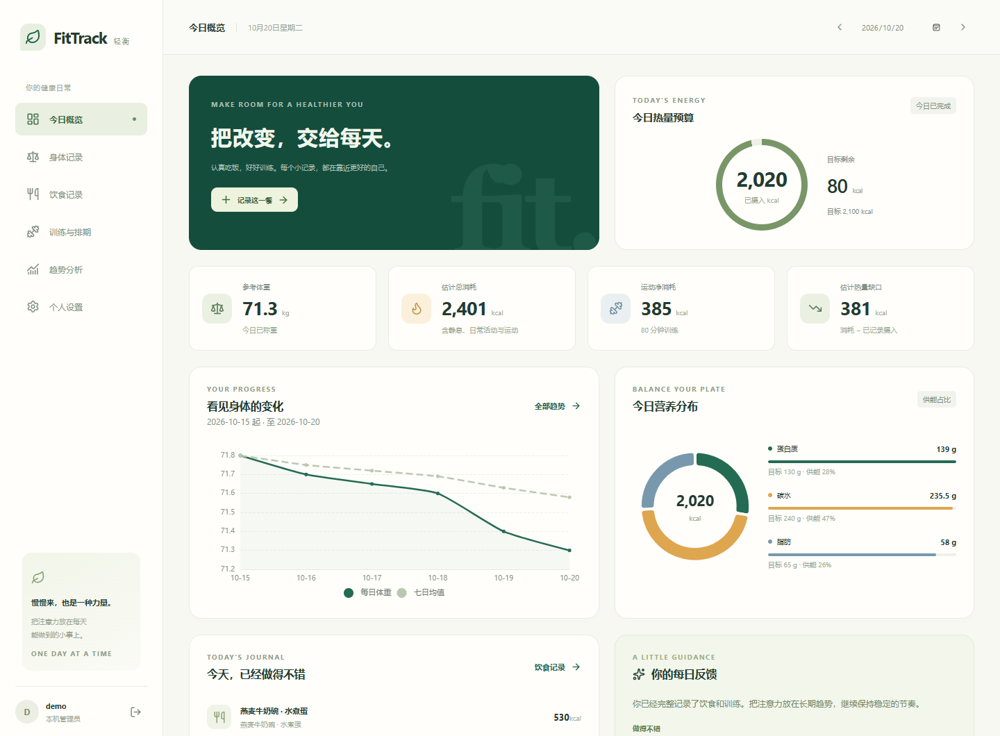
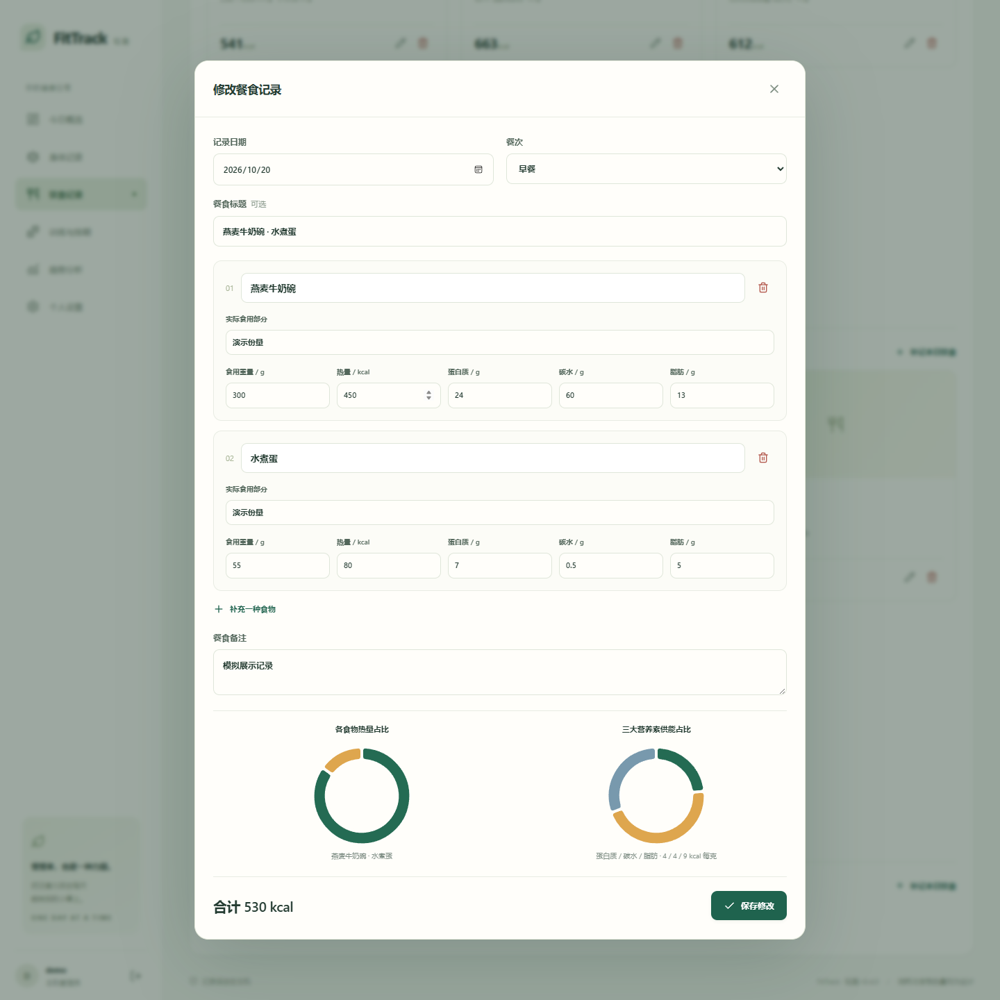
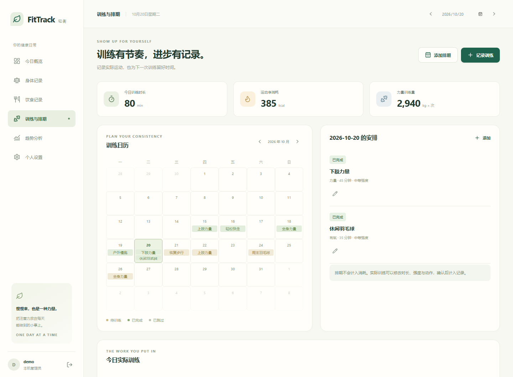
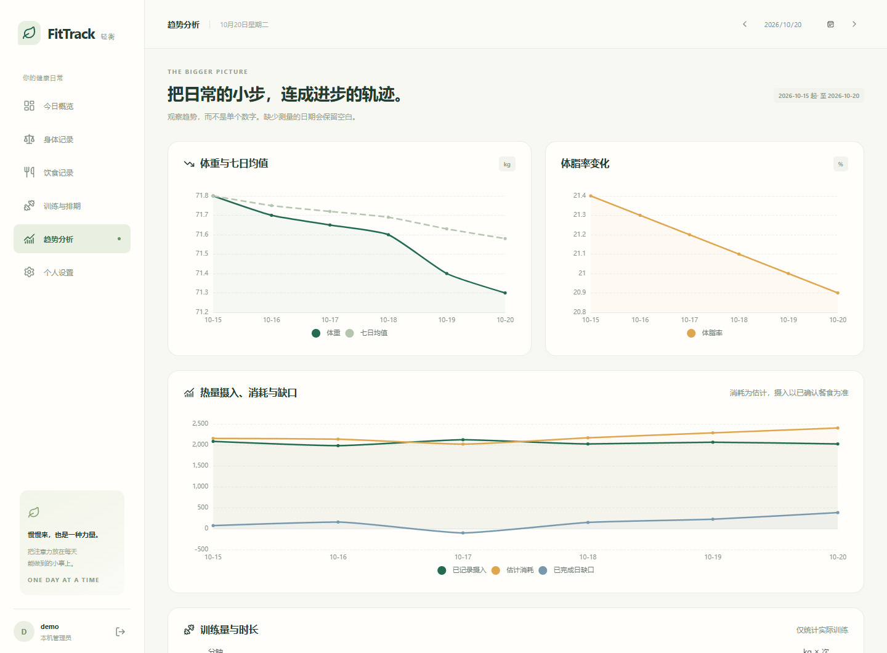

<p align="center">
  
</p>

<p align="center">
  <strong>把饮食、训练和身体变化，放进同一本日记。</strong><br />
  本地保存 · AI 辅助 · 由你决定每一步
</p>

<p align="center">
  <a href="https://github.com/LinZzzzJ/FitTrack/releases/tag/v0.4.0"></a>
  <a href="https://github.com/LinZzzzJ/FitTrack/actions/workflows/ci.yml"></a>
  <a href="LICENSE"></a>
  
</p>

<p align="center">
  <a href="https://github.com/LinZzzzJ/FitTrack/releases/download/v0.4.0/FitTrack-v0.4.0-windows-x64.zip"><strong>↓ 下载 Windows 便携版</strong></a>
  &nbsp; · &nbsp; <a href="README.zh-CN.md">使用指南</a>
  &nbsp; · &nbsp; <a href="#功能一览">功能一览</a>
  &nbsp; · &nbsp; <a href="#源码开发">源码开发</a>
</p>

<br />



<p align="center"><sub>界面展示使用模拟记录，不包含个人健康数据。米白与深绿，让信息清楚，也让记录轻松。</sub></p>

## 为长期坚持，留一点空间

FitTrack 是一款本地优先的健身记录工具。你可以记录每一餐、每次训练和每天的身体变化，用图表观察趋势，用 AI 获得可以核对和修改的建议。

完整解压后即可运行，无需安装 Python、Node.js 或 Anaconda。界面在本机浏览器打开，账号、照片与健康记录保存在你选择的目录。

| 饮食有依据 | 训练有记录 | 变化看得见 |
| :--- | :--- | :--- |
| 照片识餐、营养标签、文字餐食 AI 草稿及营养分布。 | 力量逐组记录、部位模板、计划导入、有氧和训练日历。 | 体重、体脂、估算消耗、热量收支及训练量趋势。 |

## 功能一览

| 模块 | 你可以做什么 |
| :--- | :--- |
| **今日概览** | 查看摄入、估计消耗、热量缺口、营养分布和记录进度。 |
| **身体记录** | 记录身高、体重、可选体脂及静息能量；未知时可按资料估算并选择日常活动状态。 |
| **饮食记录** | 选择 AI 估算或精确录入；AI 可拆分食物，精确模式按整餐三大营养素计算热量。 |
| **包装营养标签** | 核对每 100 克／每份／整包的数值，按实际克数或袋数换算。 |
| **训练与排期** | 使用部位模板、导入 CSV/JSON 计划、扫码交换模板，并区分有实际记录的日期。 |
| **AI 辅助** | 按需生成饮食目标、有氧估算、每日反馈与周复盘；目标与消耗草稿先预览再采用。 |
| **数据管理** | 多账号隔离、个人 API Key、自选数据目录、备份恢复及目录迁移。 |

> **源码与便携包版本：**以上新增能力已进入当前 `main` 源码（API 修订号 5），当前 Windows 源码和浏览器检查通过。下载页的 v0.4.0 Windows 便携包仍对应 API 修订号 2，不包含这些后续功能；新便携包尚未构建验收。

<br />

### 每一餐，都能核对清楚



录餐提供两个模式：AI 估算根据餐食描述（可附照片）拆分食物并生成可编辑草稿；精确录入填写整餐三大营养素总量，由后端按 4/4/9 计算热量。从 AI 草稿切换到精确录入时，三大营养素输入会清空并需重新填写；已有精确记录的编辑值会保留。包装标签仍按基准和实际份量由后端换算。膳食纤维、总糖和钠可按记录查看，未知项不会当作零；草稿确认后才入账。

### 让训练安排和实际完成连起来



力量训练逐组记录，也可从背、胸、手臂等部位模板开始；当天修改不会改动原模板。计划支持通用 CSV/JSON 导入，模板支持 JSON 和离线二维码交换。日历标记表示当天有实际训练记录，排期状态单独显示。有氧支持类型、强度、时长及自定义描述；AI 估算须预览并保存后才入账。

### 关注趋势，按自己的节奏调整



在同一处查看身体、饮食与训练的关联。每日反馈和每周复盘按需生成，AI 不会自动修改目标或训练排期。

## 五步开始

1. 从 [Releases](https://github.com/LinZzzzJ/FitTrack/releases/latest) 下载 ZIP，**完整解压**到固定、可写的程序目录。
2. 双击 **`FitTrack.exe`**，选择一个专用文件夹作为数据根目录。
3. 浏览器自动打开本机页面，注册账号并填写身体资料。
4. 如需 AI，在「个人设置 → 我的 AI 配置」填写自己的 API Key。
5. 以后通过生成的「启动／停止／重启 FitTrack」快捷方式管理后台。

> 便携包约 **20.81 MiB**，解压文件约 **45.63 MiB**。默认地址为 `http://127.0.0.1:8788`。关闭网页后后台继续运行，使用停止入口退出；不设置开机自启。

包内提供 **先读我.txt** 和可离线打开的 **首次使用指南.html**。下载页附有 SHA-256 校验文件。

## 你的数据，你来保管

- **位置明确**：首次启动由你选择数据根目录，设置页可查看账号库、记录、照片、日志及备份的位置。
- **个人 Key**：每个账号自行配置，没有共享默认 Key；保存时加密，界面不回显明文。
- **离线可记录**：手动饮食、身体、训练、计算和图表无需联网；AI 功能需要网络与个人 API 额度。
- **主动备份**：健康 ZIP 备份包含记录和照片，不包含登录密码、API Key 或主加密密钥。

AI 请求由本机后端发送，相应照片和记录摘要会交给你配置的 AI 服务。浏览器 Cookie、浏览器缓存及操作系统自身记录由它们各自管理。

## AI 配置

| 设置 | 默认值 |
| :--- | :--- |
| 服务地址 | `https://api.deepseek.com` |
| 识图与文字模型 | `deepseek-flash` |
| API Key | 留空，由每个账号自行填写 |

在 [DeepSeek 开放平台](https://platform.deepseek.com/) 获取自己的 Key，在设置页保存并测试连接。勾选记住 Key 时加密保存；不勾选则只保留在当前登录会话的后端内存中。

照片/文字识餐和运动热量均为估算；读标签时请核对单位、基准及实际份量。静息消耗公式估值不是设备实测。浏览器摄像头扫码需要 HTTPS 或 localhost；也可上传二维码图片。模型可用性、费用和响应速度以提供方为准。

## 源码开发

推荐 **Windows、Python 3.12、Node.js 24 和 Git**。在 PowerShell 中运行：

```powershell
git clone https://github.com/LinZzzzJ/FitTrack.git
cd FitTrack
powershell -ExecutionPolicy Bypass -File scripts/setup.ps1
```

安装完成后双击生成的「首次设置 FitTrack」快捷方式，选择数据目录。运行自动检查：

```powershell
powershell -ExecutionPolicy Bypass -File scripts/check.ps1
```

| 层次 | 技术 |
| :--- | :--- |
| 界面 | Svelte 5 · TypeScript · Vite · Lucide · ECharts |
| 服务 | FastAPI · Pydantic · Uvicorn |
| 存储 | SQLite WAL · 个人工作区 · 本地图片 |
| 凭据 | Argon2 密码哈希 · Fernet 加密 |
| 分发 | CPython 3.13.16 · PyInstaller 6.22.3 · Windows x64 ZIP |

详细说明：[使用与开发指南](README.zh-CN.md) · [架构](docs/ARCHITECTURE.md) · [公开验收记录](docs/ACCEPTANCE.md) · [服务器路线](docs/WEB_DEPLOYMENT_ASSESSMENT.md)

## 项目知识库与跨平台开发

准备接手开发或迁移到 Ubuntu/WSL，可从 [当前状态](docs/current_status.md) 开始，再按任务阅读专题。知识库保留实现依据、设计原因和故障经验，区分已验证能力与待实现方向。

| 想了解什么 | 文档入口 |
| :--- | :--- |
| 现在做到哪里、下一步从哪开始 | [当前状态](docs/current_status.md) · [AI 开发指南](AGENTS.md) |
| 架构、数据流和接口 | [系统架构](docs/ARCHITECTURE.md) · [接口与数据格式](docs/interfaces.md) |
| 需求与技术选择的原因 | [需求映射](docs/requirements.md) · [技术决策](docs/decisions.md) |
| Windows/WSL 环境和移植工作 | [开发环境](docs/environment.md) · [跨平台移植清单](docs/migration.md) |
| 历史故障、上下文与未解问题 | [开发经验](docs/development_notes.md) · [历史摘要](docs/history_summary.md) · [待确认问题](docs/open_questions.md) |

当前完整验收与发布仍以 Windows 为准。WSL 编辑开发、Linux 运行服务、Windows 成品打包是不同流程；已有移植说明不代表 Linux 已完整适配。Git 仓库保存源码与文档，个人健康数据和 Key 需单独备份迁移。

## 版本与边界

- v0.4.0 为 Windows 本机便携版，已在 Windows 11 x64 验收；Windows 10 为兼容目标，尚未实机验证。EXE 未签名。
- 当前图表统计起点为 **2026-10-15**；更早饮食仍可补录。每周复盘按该日期起每七天划分，需周期结束、七天均有确认餐食并完成记录。
- 健康记录按保存操作持续写入；独立备份需要主动创建。升级前停止旧版并备份，再用新程序选择原数据目录。
- 源码保留服务器模式接口基础，公网部署需要另行配置并验收。

## 开源与致谢

基于 [MIT License](LICENSE) 开源。项目的部分本地运行与工程组织方式参考 [BrushGraft](https://github.com/zeroherolin/brushgraft)，相关许可声明保留。

感谢 Svelte、FastAPI、ECharts、Lucide 及其他开源项目。便携包附完整第三方许可。

---

<p align="center"><sub>FitTrack · 轻衡<br />慢慢来，也是一种力量。</sub></p>

## Android

[下载 Android 首个预发布 APK](https://github.com/LinZzzzJ/FitTrack/releases/tag/v0.4.0-android.1)（Android 8+；真机验收待完成）。

Android 源码与签名 APK 构建流程已加入，支持本机记录与连接自己的 HTTPS FitTrack 服务器，
保留现有 FitTrack 风格。PC/手机通过健康 ZIP v1/v2 双向交换；动作库内置 48 个原创动画示意。
PC API 与数据格式继续兼容，移动同步单独版本化。使用、签名保管及未验证边界见
[Android 指南](docs/android.md)。此源码状态不代表旧 v0.4.0 Windows Release 附件已更新。
