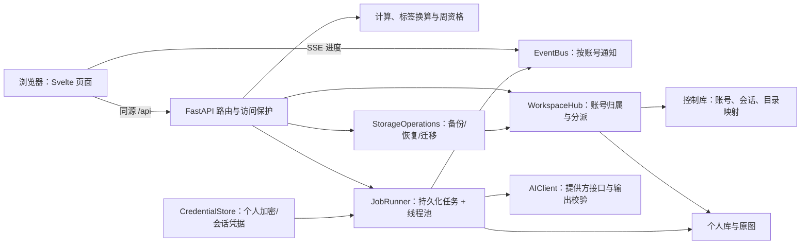

# 架构与计算

本文记录已发布 v0.4.0 基线及当前 `main` 后续源码，核对日期为 2026-10-24。当前源码 API 修订号为 5，但便携发行仍为 v0.4.0/API 2；平台验证范围见 [当前状态](current_status.md) 与 [验收](ACCEPTANCE.md)。字段合约见 [interfaces](interfaces.md)，设计原因见 [decisions](decisions.md)，平台依赖见 [migration](migration.md)。源码功能不等于便携版或 Linux/公网验收。

## 总体关系与入口



`__main__` 调用 `cli.main`，验证用户明确指定/选择的根目录，再配置进程临时目录与日志、获取实例锁、构造 `WorkspaceHub` 和 `CredentialStore`，由 `create_app` 建立路由、任务和 SSE，Uvicorn 提供服务。CLI 持有正常停服/根迁移回调；直接构造应用不自动获得全部进程管理能力。

文件职责是单向分层而不是多套独立应用：前端调用合约，路由读取会话归属，存储负责事务，计算不请求 AI；AI 提供可验证草稿，正式记录仍经保存接口写入。

## 工程组织

前端为 Svelte 5、TypeScript、Vite 单页应用，六个功能页面共用日期、账号与每日摘要状态。图表使用 ECharts，组件挂载和卸载时管理实例与 ResizeObserver；弹窗使用原生 dialog。

后端分为 app（生命周期与访问保护）、routes（认证及 HTTP 合约）、models（输入验证）、store（个人健康 SQLite 与图片）、calculations（确定性计算）、coaching（有氧上下文与周资格/统计）、ai（DeepSeek 合约）、jobs（后台队列）、events（用户推送）。0.2 新增 paths（受控根目录）、control（账号库与工作区分派）、credentials（个人加密凭据）、storage_ops（个人迁移/备份/恢复）、upgrade（旧版导入）、relocation（停服根目录迁移）、runtime/management_routes（运行模式与数据管理接口）、desktop/cli（无窗口启动）。

此工程参考 BrushGraft 的 FastAPI 静态前端、本地 SQLite + 不可变图片、单实例锁、线程池与 SSE 桥接方式。参考或适配的启动、文件发布与事件桥接设计保留 MIT 声明；图像编辑与版本树业务未引入健身应用。

## 数据模型

| 表 | 内容与约束 |
|---|---|
| users | 唯一用户名、Argon2 密码哈希、首次注册管理员 |
| sessions | SHA-256 会话令牌哈希、用户与 14 天有效期 |
| workspaces | 账号与根目录内相对路径的唯一映射（控制库） |
| ai | 每账号非敏感模型配置及 Fernet 密文，临时 Key 不入库（控制库） |
| metadata | 升级进度、旧档登记等控制信息（控制库） |
| profiles | 每人按生效日期保存的完整参数版本 |
| bodies | 每人每天唯一测量；体重、体脂、静息覆盖可空 |
| images | 用户所有权与图片 SHA-256；物理文件不可变、去重 |
| entries | 餐食、实际训练与排期的类型化 JSON；组记录和排期动作明细嵌入记录；按用户、类型、日期索引 |
| jobs | 请求、类型、状态、结果、错误、源数据指纹；用户＋request_key 唯一 |
| feedback | 每日反馈与源数据指纹，旧请求不能覆盖更新的请求结果 |
| days | 当前用户的当日完成状态 |
| workout_templates | 当前用户的可复用训练模板；动作与默认组数保存在模板 JSON 中 |

0.2 起的账号、会话、工作区映射、凭据及 metadata 位于 `R/control/accounts.sqlite3`；个人 profiles、bodies、entries、jobs、days 和 workout_templates 位于每个个人工作区的 `fittrack.sqlite3`。个人数据库仅有 owners 归属标识，不含账号密码、会话或 AI 密文。工作区分派必须有当前用户 ID，控制库保存相对根目录的路径。旧单库仅保留为显式升级读取及旧版合约回归用途，生产启动始终使用 WorkspaceHub 和 CredentialStore。

启用 SQLite 外键、WAL、busy_timeout、内存临时表，数据库操作由可重入锁协调，首次账号分配和目录映射切换使用事务。实例锁放在 `R/runtime`。根目录格式版本为 2；个人健康表仍为 user_version=1，拒绝打开更新版本数据库。迁移通过显式导入完成，不在原库中隐式拆表。

餐食 source_job_id 唯一，重复确认返回原记录。实际训练 plan_id 唯一，重复转训练返回原记录；排期完成状态由关联训练推导，删除训练后恢复待完成。真实图片、配置和数据库均由 Git 忽略。

## 日期与计算

日记录使用 Asia/Shanghai；接口日期为 YYYY-MM-DD。参数按记录日选择最近生效版本；早于初始资料日期的补录使用初始版本作为回填基础。后续新版本只向后生效，设置页面的新修改默认从今天生效。

统计起点统一为 `2026-10-15`：后端 calculations.TRACKING_START、前端 lib/tracking.ts 的同名常量。首页、身体记录和趋势分析共用状态加载，按每次最多 366 个日期分段请求；每段传入相同的 `measurement_start`，七日平均查询的下界为 max(当天−6天, measurement_start)，保证跨段连续且排除起点前测量。图表终点跟随所选日期；历史录入接口不受图表起点限制。

运动体重选择顺序：当日测量 → 当日之前最近的体重 → 初始体重，不使用未来体重。静息能量使用当日覆盖、个人手动值或公式估算。估算使用 Mifflin–St Jeor：男性 `10 × 体重kg + 6.25 × 身高cm − 5 × 年龄 + 5`，女性将常数项改为 `−161`；选择“其他”时使用两种常数项的平均值。年龄缺失时须填写静息能量。日常活动等级系数为久坐 1.2、轻度 1.375、中度 1.55、高度 1.725、非常活跃 1.9；历史自定义 `activity_factor` 继续兼容。估算值不是设备实测，也不构成医疗建议。

```text
运动总消耗 = MET × 体重 kg × 时长分钟 / 60
运动净消耗 = max(0, 总消耗 − 静息 kcal/天 × 时长 / 1440)
估计日消耗 = 静息能量 × 每日活动等级系数 + 各次运动净消耗
估计日缺口 = 估计日消耗 − 已确认餐食热量
```

新资料以活动等级选择日常系数；读取没有 `activity_level` 的旧资料时沿用其自定义 `activity_factor`，未设置时回退到 1.2。运动支持手动 MET 或运动净消耗覆盖（包括 0）。力量消耗按整次训练时长计算，逐组重量 × 次数只用于训练量。自重动作按外加重量 0 记录，保留组数与次数。

MET 来源于 [2024 Compendium](https://pacompendium.com/) 的 [力量与器械运动](https://pacompendium.com/conditioning-exercise/)、[跑步](https://pacompendium.com/running/)、[步行](https://pacompendium.com/walking/)、[骑行](https://pacompendium.com/bicycling/)；不同强度映射为选定的参考活动，个体结果并非精确测量。

羽毛球映射休闲/竞技/比赛为 5.5/7.0/9.0 MET，来源为 Compendium 的 [Sports](https://pacompendium.com/sports/)。有氧 AI 返回的是包含休息影响的整段平均 MET，后端只扣除一次该时段静息消耗。

验收：R=1800、A=1.2、W=75、MET=6、t=60，运动净消耗 375，日消耗 2535，摄入 2000，缺口 535 kcal。

后端对食物明细求和，不直接信任 AI 的 total_kcal。食物占比以餐食热量总和为分母；营养供能占比以蛋白质×4＋碳水×4＋脂肪×9 为分母，零供能时显示零比例。膳食纤维、总糖与钠单独汇总；只要当日有一项食品未提供对应值，该项日合计显示为空而不把未知当作零。两种热量口径可能因营养估计和取整略有差异。缺失测量不补零，未录入饮食的趋势不显示零摄入。

## AI 与数据归属

默认 Base URL 为 https://api.deepseek.com，模型 deepseek-flash。采用 Chat Completions，thinking=disabled、JSON 输出，识图上限 2048 tokens，建议上限 1024 tokens，连接 10 秒、响应读取 90 秒超时，不自动重试。

模型仍以非流式方式生成一个 JSON；HTTP 响应体逐字节读取以识别提供方的空行保活。每收到字节检查总等待是否超过 120 秒，超出即关闭响应并提示手动重试；无字节时仍由读取超时处理。响应体限制 2 MiB，错误分支也释放连接。参见 [DeepSeek 保活机制](https://api-docs.deepseek.com/quick_start/rate_limit/)。

目标生成使用同一个文字建议模型，输出上限 1536 tokens。`POST /api/jobs` 提交 `kind=goals` 与 `goal_profile`（完整表单草稿，目标体重必填）。未保存身体资料也可生成；不读取其他用户数据，不保存或自动覆盖资料与目标。结果以 `goals`、`basis` 与 `stale` 返回并保存在任务中；前端展示推荐理由、克数和按 4/4/9 换算的供能比例，用户采用后还需保存表单。

估计维持消耗为“草稿静息能量、估算静息能量或当日覆盖 × 日常活动等级系数 ＋ 近七个日历日已记录运动净消耗的日均值”。体重优先使用截至当天最近测量，无测量时回退草稿初始体重；没有记录的饮食保留空值，不把未记录运动推测为已经训练。不会把原有热量和营养目标传入模型影响新建议；资料未提供年龄时不编造年龄或达标期限。

AI 输出经 Pydantic 验证正数、上限和供能一致性，三大营养素与热量的误差不得超过 20 kcal 或 2%（取较大值）。本应用采用温和调整规则：减重缺口最多为维持消耗的 20% 且不超过 500 kcal；增重盈余最多 10% 且不超过 300 kcal；维持摄入与估计消耗相差不超过 5%。这些是本应用的初始建议约束，不是对个人的医疗处方。低于 1000 kcal 的模型输出直接拒绝；这个校验下限参考 [NIDDK Body Weight Planner](https://www.niddk.nih.gov/bwp)，不代表推荐摄入值。健身蛋白质提示参考 [ISSN 的 protein and exercise 立场文件](https://pmc.ncbi.nlm.nih.gov/articles/PMC5477153/)，缺少健康资料时只提供通用起点。

生成前对草稿及最近记录保存指纹，任务完成及再次读取时检查；采用前再次向后端核对。表单身体资料或目标体重发生变化时，前端也阻止采用旧建议。目标任务复用现有线程池、持久化状态、账号隔离及手动重试策略，无须数据库迁移。

图片原始字节保存在个人图片目录，上传及原图接口不裁剪或重编码。页面预览按 contain 展示完整画面，显示原图尺寸，并可打开完整照片；历史任务和已入账餐食也能查看原图。

识图副本在内存中纠正 EXIF 方向、转 RGB 并去除元数据，长边最多 4096 px，不放大小图；JPEG 质量 92、保留完整色度，超过 8 MiB 时继续等比缩小。全程不裁边、不覆盖本地原图，仍以 Base64 和 detail=high 发送，不需要公开图片网址。较此前 1600 px/质量85策略保留更多输入细节，可能增加传输量；[DeepSeek 仍会按内部规则等比缩放](https://api-docs.deepseek.com/zh-cn/guides/vision/)，不保证小字和反光标签可准确识别。图片上传限制仍为 12 MB / 4000 万像素。

包装食品提示区分每 100 克/每份/整包，按实际重量缩放，标签 kJ 除以 4.184 换算 kcal；NRV 不当作克数，每袋重量不静默等同食用袋数。普通餐食提供 AI 估算和精确录入两种模式：AI 模式可用文字描述/可选照片拆分为食物明细；精确模式使用整餐一组总量，用户填写蛋白质、碳水和脂肪，后端按 4/4/9 重算 kcal，不采信客户端 kcal。AI 草稿切换到精确录入时清空三大营养素输入，已有精确记录编辑时保留其值。精确模式重量可空，纤维、总糖和钠可空。旧记录无模式字段时仍按历史结构读取。微量营养合计若有食物缺少对应字段，该项显示为空而非零。标签模式与精确模式互斥；AI 草稿确认前不入账。

反馈使用当日及此前六天的资料、身体测量、已确认饮食和实际训练，以及今日/次日排期，不包含用户名、密码或密钥。请求前保存数据指纹，修改、补录或生成期间变化时标记过期，不覆盖用户记录。普通编辑不调用 AI。

队列最多两项同时执行。请求结果保存在 SQLite，浏览器用按用户过滤的 SSE 更新，再请求摘要恢复完整状态。服务重启后未完成任务标为 interrupted，由用户手动重试；任务错误只返回清理后的中文说明。

`cardio_estimate` 请求增加 `cardio_input={kind:"cardio", activity, duration_minutes, intensity, description}`。上下文包含日期、参考活动及 MET、当天有效体重/静息能量；文字模型上限 1024 tokens，输出 effective_met（1–25）、rationale、assumptions。后端校验后计算 gross_kcal/net_kcal，结果仅保存为任务，不写训练。采用前重新读取任务核验，保存 Workout 的 `ai_estimate_job_id` 时再检查归属、完成状态、日期与输入指纹、MET 一致且没有净消耗覆盖。身体资料变化后已存训练按有效资料重新计算并提示 AI 来源过期；手动调整需要解除来源或重新估算。

`weekly_review` 请求包含 `week_start`，date 必须为该周第七天。周期从统计起点每七天递增，截止日早于服务端上海今天才算结束；七天均有已确认餐食及 days.completed 才可生成。默认取最近已结束一期，尚未结束过一期则返回首期等待状态。资格检查在读取个人凭据和提交任务前完成；同账号同一期只允许一个排队/运行任务。

每周上下文包含七天资料、目标、实际饮食、训练及可用测量，统计由后端计算，未提供的消耗/缺口或身体趋势保留空值。文字模型上限 2048 tokens，返回 summary、diet_findings、training_findings、next_week_plan 和 limitations；记录变化时重新计算源指纹，标记报告过期。GET 状态分别选择最新成功报告和最新任务，重新生成失败不抹掉旧报告。完成日期的接口独立于每日 AI，不要求每天都生成反馈。

目标、有氧和餐食 AI 任务复用个人 Key、文字/识图模型、任务队列和 jobs 表。训练模板以新个人表保存；健康 ZIP 升为 v2 并携带模板，同时继续导入不含模板表的 v1 ZIP。备份校验检查 AI 请求/结果、模板模型和有氧来源与训练的关联；跨账号导入会重新归属，不携带凭据。恢复后的未完成任务标为 interrupted，不自动发送模型请求。

全体 /api（登录/注册除外）要求会话。所有图片、记录、任务、管理操作及事件校验所属用户；AI 配置改为每账号独立，管理员只增加本机根目录迁移/停止等管理能力，不扩大他人健康记录访问。Host/Origin 在本机模式限回环及明确的 Vite 开发源，服务器模式按部署域名和 HTTPS Origin 检查。静态 .js/.mjs 显式设置 JavaScript MIME。

## 受控路径、凭据及数据管理

首次启动在初始化业务模块之前要求选择根目录；所有数据库、日志、凭据、临时文件和进程状态从 RuntimePaths 获取路径。`-B` / dont_write_bytecode 禁止运行时在源码和依赖处生成字节码，进程 TMP/TEMP/TMPDIR/SQLITE_TMPDIR 和 tempfile.tempdir 固定 `R/tmp`。初始化不接受混入普通文件的目录，拒绝目录内符号链接和 Windows 联接，检查权限及最低可用空间；不可用时不回退。

CredentialStore 不读取公共环境 Key。默认 Fernet 加密到控制库，主密钥独立位于 `R/secrets/master.key`，仅当前 Windows 用户和 SYSTEM 可访问。会话模式的明文仅存后端内存，按账号及会话哈希索引；使用时检查会话是否有效，30 秒周期清理。任务提交仅向工作线程传凭据快照，不写任务请求或结果。所有浏览器接口只返回配置状态、非敏感参数与保存方式。

数据管理操作使用单线程池，将状态存入 `R/runtime/operations`。开始前等待该账号 AI 任务结束，暂停该账号写入；耗时复制期间不持有全局账号锁，其他账号仍可写入。个人迁移用 SQLite backup API 获取一致副本，校验 integrity_check、各表记录数和图片 SHA-256，再事务更新映射及旧档登记。旧工作区保留并标记 retired。

健康 ZIP v2 使用白名单 manifest 与 hash 命名图片，包含个人训练模板；仍可导入不含模板表的健康 ZIP v1。个人 SQLite `user_version` 仍为 1，模板通过创建表兼容既有工作区。归档限制为 512 MiB 压缩、2 GiB 解压、10002 个文件、32 MiB manifest；拒绝额外路径、重复文件、链接和无效归属。导入时将所有记录归入当前账号，在新工作区校验后切换。恢复不覆盖当前库，备份不包含密码、凭据或主密钥。本机备份写入根目录，不自动下载；服务器提供主动下载。

整根迁移在 HTTP 服务停止、线程任务结束、数据库关闭后执行，迁移期间保留原实例锁。复制非临时文件并逐文件校验，验证账号库及个人库和凭据，再重新绑定快捷方式、重启并核对新实例就绪。旧根目录保留。旧版导入仅在新根目录暂存区进行 SQLite 恢复读取，保留 ID 和密码哈希，不导入会话；原管理员明文 Key 确认加密后从旧配置移除。

`local/server` 共用业务及备份协议；服务器模式无本机原生目录/停止/根迁移能力，启用 Secure Cookie、部署域名与可信代理，保存和使用 AI 地址都验证 HTTPS 允许列表。实际部署步骤与两条路线的数据位置区别见 [网页部署技术评估](WEB_DEPLOYMENT_ASSESSMENT.md)。

## 主要接口

v0.3 新增 `version`（载入时后端源码指纹、当时的 API 修订号 2 及能力）和 `nutrition`（确定性标签计算）。当前 `main` API 修订号为 5。`GET /api/version` 无需登录，遵守 Host/Origin 保护，仅返回非敏感版本信息；前端提交前检查接口版本、能力和重启标志，版本不匹配时保留表单并阻止提交。后端源码变动后除认证及本机管理外暂停写入，正常重启后恢复；不会吞掉不认识字段来兼容旧后台。

饮食周视图独立查询最多七天，支持统计起点之前的日期。顶部日期决定默认周，翻周不改变记录归属日期；异步查询用代次丢弃过时结果，保存/任务进度后刷新。标签任务复用kind=meal，新增meal_mode=photo|label默认photo，label结果可包含null并保存为草稿；标签计算要求必要数值完整、有限且份量为正，按kJ/4.184及基准重量换算。Meal.nutrition_label保留原标签和份量，items由后端重算；重复确认、图片/任务归属及旧数据结构继续兼容。备份恢复会验证标签与营养结果一致，无SQLite表版本迁移。

- POST /api/auth/register、/login、/logout；GET /api/me。
- GET/PUT /api/profile；PUT /api/body；GET /api/body?start=&end=；DELETE /api/body/{date}。
- POST /api/uploads；GET /api/images/{id}?thumb=true。
- POST、PUT /{id}、DELETE /{id}：/api/meals、/api/workouts、/api/plans。
- GET /api/plans?start=&end=；POST /api/plans/{id}/complete。
- GET /api/workout-days?start=&end= 返回实际训练日期；GET/POST/PUT/DELETE /api/workout-templates[/{id}] 管理账号私有模板。
- GET /api/days/{date}；POST /api/days/{date}/complete；GET /api/trends?start=&end=&measurement_start=（最长 366 个日期，measurement_start 可选）。
- GET /api/weekly-review?week_start=：周期、完成进度、缺失原因、资格、运行任务及最新成功报告；日期可省略。
- POST /api/jobs；GET /api/jobs/{id}；GET /api/events。
- DELETE /api/jobs/{id}：仅删除当前账号已结束的餐食分析。成功204，不存在/越权/非餐食任务404，排队或运行中409。单个事务解除餐食的来源字段后删除任务，保留餐食、标签快照和图片；通过当前账号的job_deleted事件刷新页面，不改变营养汇总或AI反馈指纹。
- GET /api/version：版本、接口修订号、能力、后端指纹及restart_required，不暴露路径。
- GET /api/diet-history?start=&end=：最多七天的当前账号餐食、摄入及照片任务。
- POST /api/jobs kind=meal：照片、文字描述或二者组合生成营养草稿；必须人工确认才入账。
- POST /api/nutrition-label/preview：标签与份量换算，不写入健康记录。
- PUT /api/settings、DELETE /api/settings/key、POST /api/settings/test-connection：当前账号个人配置。
- GET /api/storage、/api/runtime；POST /api/storage/pick-directory、/migrate、/open；GET /api/storage/operations/{id}。
- GET/POST /api/backups；POST /api/backups/restore、/import；GET /api/backups/{id}/download（仅服务器）。
- POST /api/local/stop、/root-migration：本机管理员；/_local 健康和停止供绑定启动器使用，停止令牌不向网页返回。

## 验收工具

scripts/check.ps1 运行离线 pytest、Ruff、前端检查与构建。browser_check.py 使用明确隔离根目录、模拟 AI 和无头 Edge 验证业务、个人 Key、备份/迁移及窄窗口；runtime_check.py 验证原生 pythonw 无窗口、快捷方式、固定端口、重复启动与整根迁移重启。测试和截图均位于安装目录下明确的 artifacts 测试根目录；不会使用系统临时目录保存测试数据库。

live_check.py --allow-paid 执行两次真实请求，加 --goals-only 只进行一次目标生成。隐藏询问个人 Key、会话内存保存，使用独立测试账号，产物留在专用测试根目录。该工具不属于默认检查，本轮没有执行真实付费请求。

## 0.4 Windows 便携分发

使用官方CPython 3.13.16 x64嵌入式运行时，在独立构建目录安装锁定的生产依赖和PyInstaller 6.22.3。产物采用无控制台onedir目录，ZIP只带EXE、_internal运行组件、前端静态文件、构建清单和中文TXT/离线HTML指南。没有Python安装器、Node、开发浏览器、测试数据或个人配置。Pillow专用hook仅打包应用支持的JPEG、PNG、WebP、GIF插件，保留原图与EXIF方向处理，不收集上传接口已拒绝的AVIF组件。

distribution模块统一源码/冻结程序安装路径、资源和自身重启命令；冻结版子进程重新初始化PyInstaller环境，不引用开发机.venv。目录选择使用ctypes调用Windows IFileOpenDialog，不依赖Tcl/Tk。网页发起选择时启动同一EXE的独立目录选择模式，结果原子写入R/tmp的随机JSON，读取后清理；取消写入null，不依赖无控制台环境的stdout。首次启动取消前不初始化账号库和主密钥。

应用启动浏览器、PowerShell、icacls及资源管理器前，暂时清除PyInstaller DLL搜索路径和子进程环境中的打包变量，完成后恢复。系统HTTP关联指向Edge/Chrome时显式使用--new-window，不操作用户浏览器进程；其他浏览器通过系统关联打开。快捷方式由系统PowerShell绝对路径生成，分析缓存固定R/caches/powershell。应用临时文件仍固定R/tmp，运行数据位置规则保持不变。程序目录只额外写绑定根目录的快捷方式；浏览器与Windows自身记录不在应用位置保证内。

源码版保留源码指纹检查；冻结版依据随包build-info.json检查加载身份，API修订号仍为2，新增distribution与build_id。构建清单含版本、运行时版本、后端指纹、前端文件哈希及打包配置/依赖锁哈希，无数据路径或凭据。文件清单对包内文件逐一记录体积和SHA-256，压缩包另附总校验文件。

prepare_release.ps1下载固定官方ZIP并核对SHA-256，不注册全局Python。build_release.py负责构建、收集Python及前后端第三方许可、归档和体积统计；audit_release.py核验最终ZIP。check_portable_release.py以移除开发工具路径的子进程环境启动实际解压EXE，验证原生对话框、功能、备份、迁移和重启；check_portable_ui.py用独立Edge配置检查实际成品界面及离线说明。测试数据、截图和缓存全部位于artifacts隔离目录，不使用正式数据根目录。

## 核心数据流与平台边界

| 流程 | 调用链与提交边界 |
|---|---|
| 餐食/标签 | 上传 → `Store.put_image` 保存原字节 → `JobRunner.submit` 检查归属和个人凭据 → `AIClient` 编码/识别/校验 → jobs 草稿 → 用户确认 → `Store.save_entry`，标签另经 `label_food` 重算 → `summary` |
| 身体/训练 | 请求模型验证 → 按当前账号和日期保存 → `effective_weight`/有效资料 → `workout_energy`/`nutrients` → 当日摘要与趋势 |
| 有氧/目标 | 收集表单和有效身体背景 → 保存源指纹并排队 → 输出验证 → 预览/采用时核对指纹 → 保存资料或实际训练才生效 |
| 每周复盘 | `weekly_status` 检查服务器日期/7天饮食及完成标记 → 个人 Key → 后端统计 → 生成报告 → 保存成功结果，旧成功报告与最新任务分别选择 |
| 数据管理 | 验证目标/归属 → 对应账号维护锁 → 一致副本/清单 → 完整性与图片哈希 → 切换相对映射 → 保留旧档；整根迁移先停 HTTP/任务/数据库 |

代码树中的 `config.Settings` 和不带 `owner_id` 的 `Store` 仍能支撑旧版导入/回归，这与 CLI 生产使用受控 `WorkspaceHub`/`CredentialStore` 的路径不同。研究旧代码时应沿入口确认实际依赖，不能因为某类保留了环境 Key 读取就判断当前新账号有默认公共 Key。

`paths.private` 在 Windows 设置 ACL，非 Windows 使用 chmod；`config.lock_home` 已有 msvcrt/flock 分支。相对工作区映射和普通 Python 业务提供移植基础，但源码子进程解释器、原生目录选择、快捷方式、文件浏览、冻结环境及部分测试仍依赖 Windows。`RuntimeConfig.capabilities` 只按 local/server 开关，尚未完整反映 OS 差异；需要未来适配与双平台验收。

当前与早期设计的主要演进：单库/公共配置 → 控制库与个人库/个人凭据；当天饮食列表 → 长期保存的周视图；普通照片包装提示 → 独立标签草稿和后端换算；仅源码启动 → Windows完整便携包。尚未实现的服务器上线、Linux完整运行和规模化队列应保留为后续方向，不能写成当前交付。

## Android 服务适配

Android 复用 Svelte 页面，通过移动服务门面读取 SQLCipher journal；原生桥接负责 Keystore、
受限 HTTPS 和文件分享。Python 模型及目录导出为共享契约，JSON 校验器在构建前预编译。
移动记录通过严格健康 ZIP v1/v2 映射回 PC 格式；同步元数据独立保存，服务器通过
个人工作区内的修订记录、回执和冲突副本适配已有 PC 写入。业务日期与确定性公式保持一致。
详见 [Android 设计与验证边界](android.md)。
